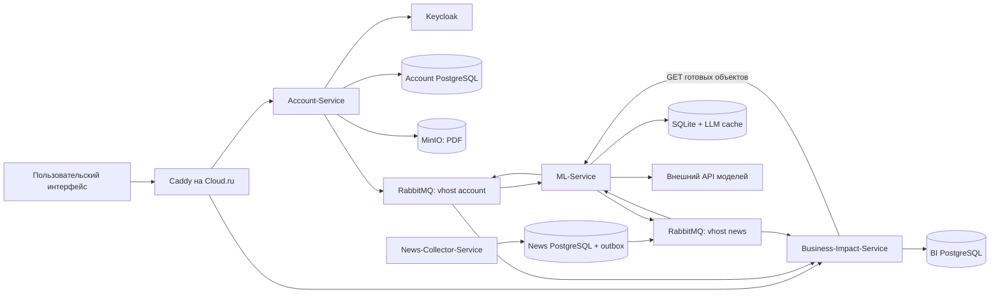
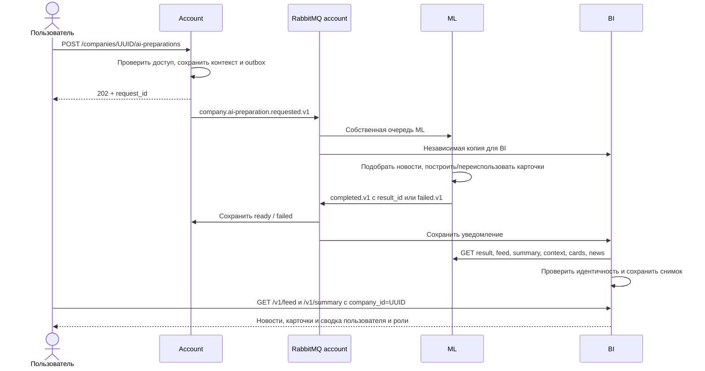

# Архитектура

## Границы ответственности

Account владеет доступом пользователя и фактами компании. News-Collector владеет
исходными публикациями. ML вычисляет интерпретацию и влияние. BI сохраняет готовые
результаты и предоставляет чтение. Insight организует вопросы и историю диалога,
используя BI для авторизации и ML для ответа.

Каждый сервис владеет своей БД. Прямого чтения чужих PostgreSQL из прикладного
кода нет. Межсервисные границы — HTTP и события RabbitMQ.

Go API-Gateway и Insight — отдельные реализованные компоненты, пока не
развёрнутые в этом Cloud.ru-окружении. Их связи описаны на страницах
[Gateway](services/gateway.md) и [Insight](services/insight.md).

## Подготовка аналитики

`ready` в Account означает завершение ML. Готовность BI проверяется отдельно:
`GET /v1/analyses/{request_id}/sync` → `state=synced`.

## Сбор новостей

1. Отдельные workers ЦБ и Интерфакса получают RSS и текст страниц.
2. Исходная новость и outbox сохраняются в одной транзакции News PostgreSQL.
3. Outbox-worker публикует `news.collected.v1`.
4. ML разбирает новость без контекста компании: предложения, summary, importance,
   классификация, шаблоны и извлечённые значения.
5. ML публикует `news.article.processed.v1`; BI сохраняет общую обработанную новость.
6. Карточки под конкретную компанию строятся при её подготовке. На сервере
   `AUTO_CARDS=0`; это не отключает обработку команд Account.

## Слои кода

Account, News и BI используют разделение domain → application → ports и
infrastructure/presentation. Domain/application не зависят от FastAPI, SQLAlchemy
или RabbitMQ. Точки входа API и workers собирают зависимости явно.
ML использует собственную модульную структуру `alfa_ml`; это не тот же шаблон DDD.
Go Gateway и Insight имеют свою структуру пакетов и отдельные контракты.

## Идентификаторы и оценки

| Поле | Значение |
|---|---|
| `company_id` | UUID компании Account; основной ID в BI и Insight |
| `external_id` / `company_external_id` | `U_*`, ID компании из набора организаторов |
| `requested_by` | UUID пользователя Account/Keycloak |
| `F_*` | Внешний ID демопользователя; не замена JWT subject |
| `request_id` | Один запуск подготовки, созданный Account |
| `result_id` | Сохранённый результат ML; может переиспользоваться между заданиями |
| `news_id`, `event_id` | ID новости и события; совпадение зависит от конкретного контракта |
| `card_id` | Непрозрачная строка карточки; берите из ответа |
| `context_version` | SHA-256 канонического снимка бизнес-контекста |
| `article.importance` | Общая важность новости, 1–5 |
| `card.score` | Балл соответствия новости компании |
| `rank_raw` BI / `rankRaw` ML | Ранг с учётом пользовательского профиля |
| `rank` | Готовая оценка 1–10 для интерфейса; при отсутствии оценки `null` |
| `status` | `high_risk`, `opportunity`, `unaccounted`; без карточки — `not_analyzed` |
| `level` | Отдельный уровень: `low`, `medium`, `high` |

Важность новости, соответствие компании и ранг — разные величины. Один сюжет
может дать разные последствия для разных компаний. Одна компания имеет много
карточек, а не одну карточку на весь бизнес.

Источники: [Account architecture](https://github.com/Alfa-future-hack-okoAI/Account-Service/blob/main/ARCHITECTURE.md),
[BI architecture](https://github.com/Alfa-future-hack-okoAI/Business-Impact-Service/blob/main/ARCHITECTURE.md).
