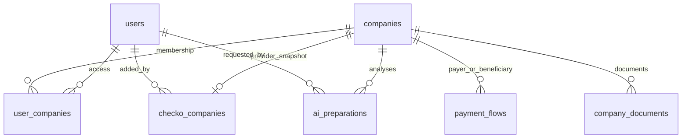
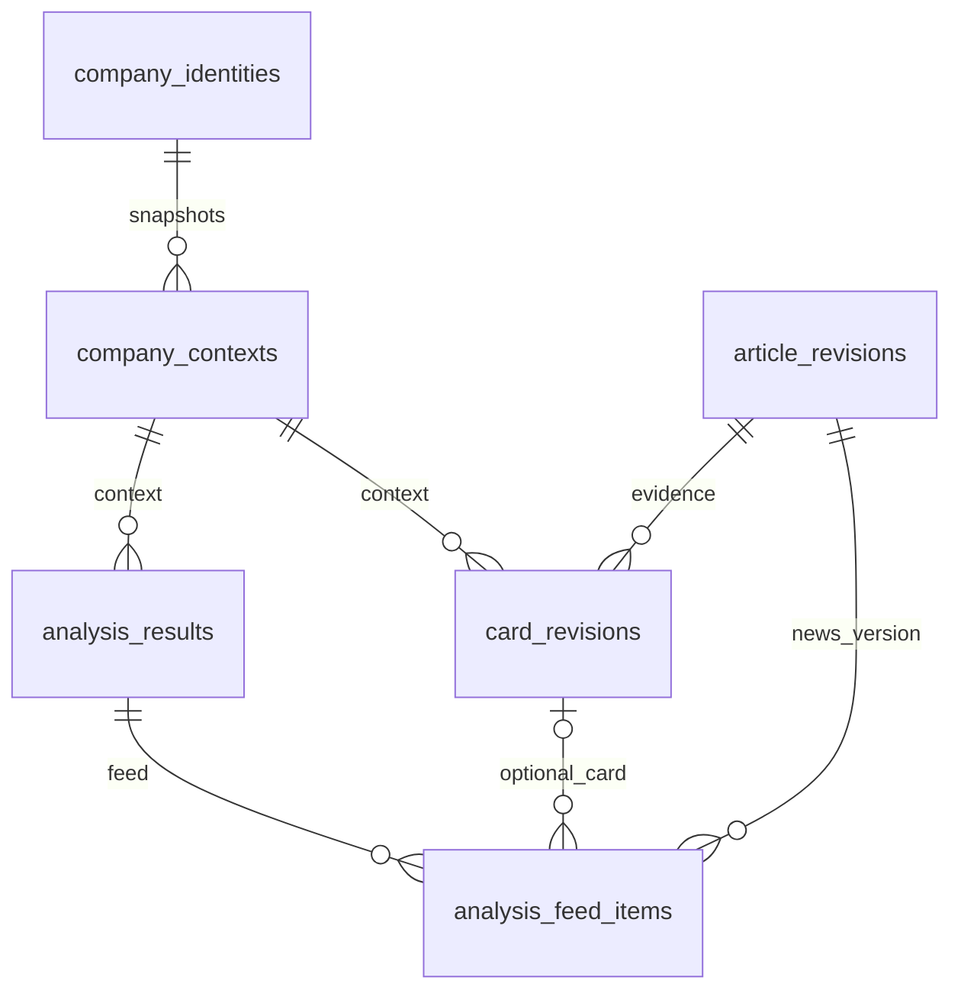

# Модель хранения

Сервисы разделяют данные по владельцам. PostgreSQL базы Account, News, BI,
Keycloak отдельные. ML использует SQLite, Insight — собственный PostgreSQL.
Между БД сервисов нет общих foreign key и прямых прикладных join.

## Account

| Таблица / хранилище | Содержимое |
|---|---|
| users | UUID, F_*, телефон, имя, демопрофиль; пароля нет |
| companies | UUID, source fixture/checko, U_*/CHECKO_*, профиль и бизнес-профиль |
| checko_companies | company_id, user_id, ИНН, типизированные снимки реквизитов/финансов JSONB, fetched_at |
| user_companies | Доступ user↔company и роль в этой компании |
| payment_flows | Направление payer→beneficiary, сумма, число платежей, исходная строка |
| company_documents | Компания, тип, год, пользователь, метаданные и object_key PDF |
| ai_preparations | Автор, компания, idempotency, контекст и терминальный результат |
| outbox_events | Подлежащие публикации команды и попытки доставки |
| MinIO | Тела PDF; PostgreSQL хранит только ссылки/метаданные |

Уникальность payment_flows основана на source_row: неоднозначные повторы из
источника не удаляются по совпавшей сумме. Связь user_companies определяет доступ;
роль в глобальном профиле пользователя не заменяет роль в выбранной компании.
Пароль Keycloak не дублируется в users.

Миграция Чекко задаёт `source=fixture` всем существующим компаниям. Новые
снимки отделены от исходных записей, уникальна пара `(user_id, inn)`.
Синтетические имена уникальны только внутри fixture-каталога; реальные названия
могут повторяться. Миграция не удаляет связи, платежи или задания, а её откат
запрещён при сохранённых компаниях Чекко.

## News

`news`: id, source/external_id, title/content/url, даты, RSS и content_status/error.
Уникальная пара source/external_id. `outbox_events`: JSON, attempts, next_attempt_at,
published_at и last_error. Новость и pending outbox создаются транзакционно.

## ML: SQLite

Таблицы `events`, `articles`, `cards`, `card_history`, `profiles`, `companies`,
`overrides`, `drafts`, `results`, `responses`, `feedback`. Объекты сохраняются
также как JSON; история карточек и профилей имеет версии. Отдельный SQLite
используется для кеша LLM. `polish` добавляет role_views; её нет в dev-логике.

Постоянный серверный volume ml_state хранит runtime. Обновление image не должно
заменять его снимком snapshot из репозитория: иначе теряются новые результаты.
CSV и сгенерированные имена компаний приходят из подготовленных данных Account.

## BI: нормализация плюс исходные снимки

| Таблица | Ключ / назначение |
|---|---|
| inbox_events | event_id, hash; дедупликация и происхождение |
| company_identities | UUID↔U_*, уникальный внешний ID |
| company_contexts | company_id + context_version, полный контекст |
| article_revisions | news_id + revision, JSON и hash |
| card_revisions | card_id + revision; FK на точную статью и контекст |
| analysis_results | request_id; автор, роль, started/finished, полный payload |
| analysis_feed_items | request_id + news_id, ссылки на версии article/card, ML display |
| ml_sync_jobs | requested/finished, состояние, попытки, lease, next_attempt, last_error |

Нормализованная карточка сохраняет исходный `ml_card`; анализ — ml_result,
ml_summary, ml_company и source_event. Это объясняет большой объём подробных
ответов. BI revision и ML card.version — разные счётчики.
Для воспроизводимого обсуждения используйте card_id + BI revision и точные
news_revision/context_version.

Индекс company_id/role/started_at используется для последнего анализа;
requested_by дополнительно ограничивает персональную выдачу. Более поздняя
доставка старого задания не делает его новым расчётом.

## Insight

`conversations`: владелец, company_id, роль, даты и next_sequence.
`chat_turns`: порядковая реплика, сообщение, выбранная карточка/ревизия/контекст,
status и ссылка на operation. `operations`: UUID idempotency, digest запроса,
владелец, deadline, pending/succeeded/outcome_unknown, исходный статус/ответ.
Миграция выполняется при запуске под advisory lock.
История переживает рестарт процесса, но не передаётся в ML автоматически.

## Неизвестные данные и точность

Суммы/доли Account передаются Decimal-строками. Null означает неизвестность,
а не нулевую выручку или отсутствие риска. Источники не задают период/валюту
части платежей; warnings нужно сохранять. Синтетические названия и роли —
демонстрационные реквизиты. Источники и ограничения не следует удалять из
хранилища ради уменьшения ответа ленты.

Исходные ORM/DDL: [Account](https://github.com/Alfa-future-hack-okoAI/Account-Service/tree/main/src/modules),
[BI](https://github.com/Alfa-future-hack-okoAI/Business-Impact-Service/blob/main/src/modules/impacts/infrastructure/database/models.py),
[ML](https://github.com/Alfa-future-hack-okoAI/ml/blob/a49ff948dd64ce3298a94b6a0f65f5a17e595750/alfa_ml/store.py),
[Insight](https://github.com/Alfa-future-hack-okoAI/Insight-Service/blob/541337d23ff0cab3c1f7e84702c28723e093d921/internal/store/migrations/0001_conversation_history.sql).
