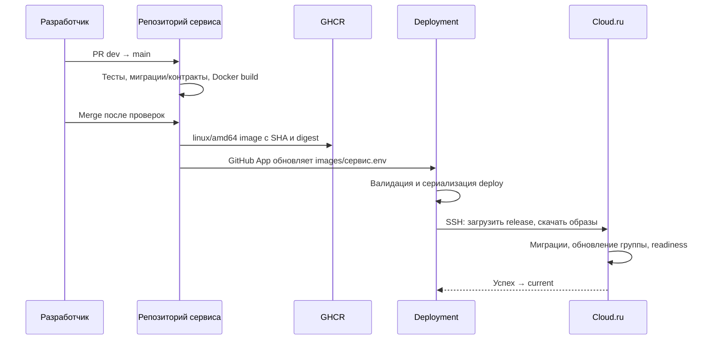

# Деплой и CI/CD

## Что хранится в репозиториях

| Где | Что |
|---|---|
| Репозитории Account/BI/News/ML | Код, Dockerfile, тесты, сборка и публикация своего образа |
| Deployment | Общий Compose, Caddy, scripts, закреплённые image digest |
| Сервер shared | Runtime env, секреты, устойчивые фикстуры и исходные CSV |
| Volumes | PostgreSQL, MinIO, RabbitMQ, ML SQLite/cache |
| Docs | Описание, публичные схемы и безопасные примеры |

Локальные Compose остаются в сервисах для разработки. Подъём серверных БД,
Keycloak, RabbitMQ, MinIO и сетей описывает Deployment. Он не собирает backend
из исходников на удалённом сервере.

## От dev до сервера



Само открытие PR не выкатывает сервер. Публикация происходит при push в main
после merge. Обычный workflow_dispatch сервиса не заменяет это условие.

Manifest `images/account.env`, `business-impact.env`, `news-collector.env`,
`ml.env` содержит image `@sha256:...` и source commit. `buildcache` не является
runtime-версией. Новая версия одного приложения обновляет его группу;
изменения общей конфигурации могут обновить все группы.

## Требуемые настройки GitHub

У сервисов: variable `DEPLOYMENT_APP_ID`, environment `release` только для main,
secret `DEPLOYMENT_APP_PRIVATE_KEY`, packages:write у publish-job.
GitHub App имеет Contents write только к Deployment; токен выпускается на job.

У Deployment: environment `production`, secrets DEPLOY_HOST, DEPLOY_SSH_KEY,
DEPLOY_KNOWN_HOSTS. В GHCR каждому используемому приватному пакету нужно
предоставить Deployment Actions Read. Это отдельное право от публикации пакета.
Личные PAT и секретные ключи в YAML не добавляются.

## Сервер и постоянное состояние

Сервер: `45.155.204.229`, пользователь удалённых команд `deploy`.
Корень нового стенда: `/home/deploy/okoai`.

```text
okoai/
├── shared/
│   ├── production.env
│   ├── account.env
│   ├── business-impact.env
│   ├── news-collector.env
│   ├── ml.env
│   ├── account-source/
│   └── account-generated/
├── releases/DEPLOYMENT_SHA/
├── state/
├── current  → последний успешный release
└── previous → предыдущий успешный release
```

Первый bootstrap создаёт инфраструктуру, стабильные generated-данные,
импортирует Keycloak realm, применяет миграции и seed. Следующие релизы
не генерируют новые пользовательские пароли и не пересоздают volumes.
Смена исходных CSV — отдельная миграция данных, не обычная выкладка.

ML runtime использует новый LLM_BASE_URL из shared/ml.env. Настройки обновляются
Deployment `scripts/configure_ml.py`, который сохраняет существующий ключ.
Не возвращайте старый default Railway случайным копированием .env.example.

## Проверка выпуска

1. Дождаться success workflow сервиса, включая publish.
2. Проверить новый digest и source SHA в Deployment main.
3. Дождаться success Deployment, а не только сборки контейнера.
4. Сверить image revision работающего API и worker, readiness и Gateway.
5. Проверить пользовательский запрос с JWT и, для нового потока, фактическое
   заполнение BI. Healthy контейнер не доказывает успешный импорт задания.

26.10.2026 проверен релиз BI `afc14cc`, Deployment `e32b30f`: endpoint последнего
анализа возвращает 200 для сохранённого результата, карточки доступны, отсутствие
JWT даёт 401, чужая компания — 403. ML остался на прежнем digest dev-логики.

## Сбой и возврат версии

current меняется после успешной выкладки. Если deploy упал, часть процессов
уже могла обновиться: указатель current не выполняет автоматический rollback.
Возврат требует выбора прежнего digest и проверки совместимости миграций/данных.
Не используйте down --volumes или глобальный prune для «починки» релиза.

Go Gateway/Insight пока не имеют интеграции с этим пайплайном Deployment.
Сценарий product/up.sh описан отдельно в [окружениях](environments.md).

Каноническая инструкция и scripts: [Deployment](https://github.com/Alfa-future-hack-okoAI/Deployment/tree/e32b30f1525eb686e028837b49bca8172c04933f).
